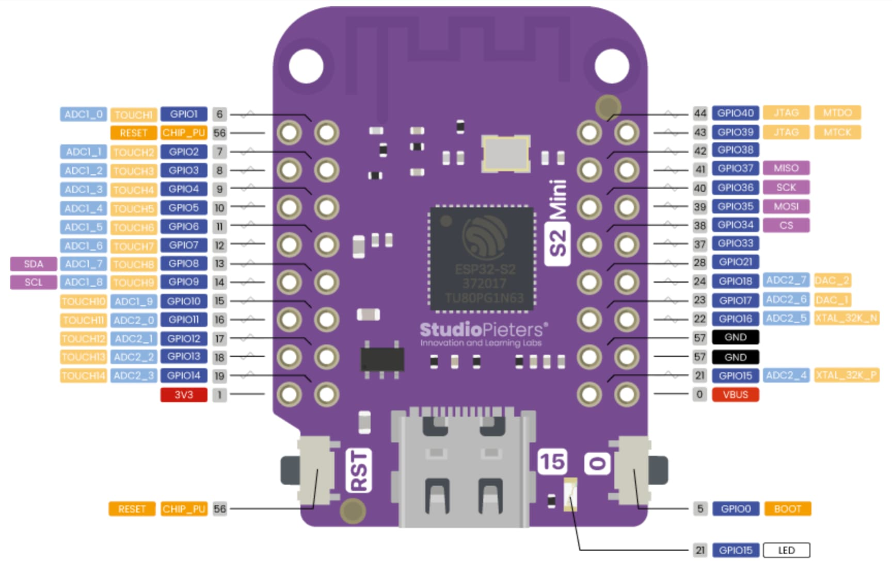

# Wiring — Zora Drone (ESP-Drone di LOLIN S2 Mini)

Legenda status:
- **[KODE]** = diverifikasi dari source esp-drone (file:baris disebut)
- **[SCH]** = diverifikasi dari schematic/pinout resmi Wemos S2 Mini v1.0.0
  (`sch_s2_mini_v1.0.0.pdf`, https://www.wemos.cc/en/latest/s2/s2_mini.html)
- **[ASUMSI]** = belum terverifikasi, wajib dicek di meja
- **[USULAN]** = menunggu konfirmasi Yusuf

---

## 1. Pinout S2 Mini yang relevan [SCH]



Gambar: StudioPieters. Label `SDA`/`SCL` di GPIO8/9 itu default Arduino. Proyek ini memakai **I2C0 di GPIO11 (SDA) / GPIO10 (SCL)**, lihat §2.

GPIO yang keluar di header: **1–18, 21, 33–40**. Plus `EN`, `3.3V`, `VBUS`, `GND` x2.

- **Tidak ada di header:** GPIO 19/20 (USB), 26–32 (flash/PSRAM), **41, 42**, 43–46.
- **GPIO0** = tombol BOOT. **GPIO15** = LED biru onboard (lewat 2k). **GPIO18** punya pull-up 10k (R4) ke 3V3.
- **VBUS** tersambung **langsung** ke VBUS USB-C dan ke input LDO ME6211C33 (3,3 V, maks 500 mA).
  **Tidak ada dioda di antara USB dan pin VBUS.**

## 2. Tabel pin final

| Fungsi | Kconfig | GPIO default profil S2 | Ada di S2 Mini? | **GPIO final** | Catatan |
|---|---|---|---|---|---|
| Motor M1 | `MOTOR01_PIN` | 5 | ya | **5** | Ke **Gate** AO3400 #1, bukan ke motor langsung (§3) |
| Motor M2 | `MOTOR02_PIN` | 6 | ya | **6** | Ke **Gate** AO3400 #2, bukan ke motor langsung (§3) |
| Motor M3 | `MOTOR03_PIN` | 3 | ya | **3** | Ke **Gate** AO3400 #3, bukan ke motor langsung (§3) |
| Motor M4 | `MOTOR04_PIN` | 4 | ya | **4** | Ke **Gate** AO3400 #4, bukan ke motor langsung (§3) |
| I2C0 SDA (MPU6050) | `I2C0_PIN_SDA` | 11 | ya | **11** | |
| I2C0 SCL (MPU6050) | `I2C0_PIN_SCL` | 10 | ya | **10** | |
| MPU6050 INT | `MPU_PIN_INT` | 12 | ya | **12** | **WAJIB** disambung, lihat §5 |
| ADC baterai | (hardcode) | 2 | ya | **2** | Tidak bisa dipindah tanpa ubah kode, lihat §4 |
| I2C1 SDA (VL53L0X) | `I2C1_PIN_SDA` | 40 | ya | **40** | |
| I2C1 SCL (VL53L0X) | `I2C1_PIN_SCL` | 41 | **TIDAK** | **33** [USULAN] | 33 bebas, tepat di samping 34 |
| SPI MISO (PMW3901) | `SPI_PIN_MISO` | 37 | ya | **37** | tahap akhir |
| SPI MOSI (PMW3901) | `SPI_PIN_MOSI` | 35 | ya | **35** | tahap akhir |
| SPI CLK (PMW3901) | `SPI_PIN_CLK` | 36 | ya | **36** | tahap akhir |
| SPI CS (PMW3901) | `SPI_PIN_CS0` | 34 | ya | **34** | tahap akhir |
| LED merah | `LED_PIN_RED` | 8 | ya | 8 | opsional |
| LED hijau | `LED_PIN_GREEN` | 9 | ya | 9 | opsional |
| LED biru | `LED_PIN_BLUE` | 7 | ya | 7 | opsional |
| Buzzer +/- | `BUZ1/BUZ2` | 39/38 | ya | — | OFF (`BUZZER_ON=n`), tidak dipasang |
| EXT01 | `EXT01_PIN` | 1 | ya | — | tidak dipakai kode mana pun |

Sumber default: `main/Kconfig.projbuild:111-349` [KODE].
Semua pin final tidak bentrok dengan GPIO 0, 15, 19/20, 26–32.

---

## 3. Driver motor (x4, identik)

Brushed low-side switch. Per kanal Mx (x = 1..4):

```
 LiPo+ ─────────┬──────────┬───────── (rail +BATT, kabel tebal)
                │          │
            motor +     katoda (garis)
             MOTOR        SS14
            motor -     anoda
                │          │
                ├──────────┘
                │
                ▼ Drain (pin 3)
                     ┌──────┐
 GPIO Mx ──[100Ω]────┤ G  AO3400 (A09T)
          (opsional) │      │
              │      └──┬───┘
            [10k]       │ Source (pin 2)
              │         │
 GND ─────────┴─────────┴──────────── (GND bersama, kabel tebal)
```

Ringkas:
1. `LiPo+` → kabel **+** motor.
2. Kabel **−** motor → **Drain** AO3400.
3. **Source** AO3400 → GND.
4. **Gate** ← GPIO motor. Resistor seri 100 Ω opsional. Tanpa resistor tetap jalan untuk PWM pelan.
5. **10k Gate → GND**. Ini wajib: MOSFET tetap OFF saat ESP reset/boot, ketika GPIO masih floating.
6. **SS14 paralel motor**: **katoda (garis) ke sisi +LiPo**, anoda ke Drain (sisi − motor).
   Kalau terbalik, SS14 jadi short saat MOSFET ON → MOSFET/dioda panas atau terbakar.

### Wiring per motor

GPIO **tidak** ada di jalur arus motor. Arus motor lewat Drain → Source → GND.
GPIO cuma ke Gate, sebagai "tombol saklar". Kabel − motor **tidak boleh** langsung ke GND,
karena motor akan langsung berputar penuh begitu LiPo dicolok.

**Motor 1 (M1, PH, depan-kanan)**
- Kabel **putih (+)** → LiPo+
- Kabel **hitam (−)** → AO3400 #1 kaki **Drain**
- AO3400 #1 kaki **Source** → LiPo− / GND
- AO3400 #1 kaki **Gate** → **GPIO 5**
- 10k: **Gate** → GND
- SS14: garis → LiPo+, polos → Drain

**Motor 2 (M2, MB, belakang-kanan)**
- Kabel **merah (+)** → LiPo+
- Kabel **biru (−)** → AO3400 #2 kaki **Drain**
- AO3400 #2 kaki **Source** → LiPo− / GND
- AO3400 #2 kaki **Gate** → **GPIO 6**
- 10k: **Gate** → GND
- SS14: garis → LiPo+, polos → Drain

**Motor 3 (M3, PH, belakang-kiri)**
- Kabel **putih (+)** → LiPo+
- Kabel **hitam (−)** → AO3400 #3 kaki **Drain**
- AO3400 #3 kaki **Source** → LiPo− / GND
- AO3400 #3 kaki **Gate** → **GPIO 3**
- 10k: **Gate** → GND
- SS14: garis → LiPo+, polos → Drain

**Motor 4 (M4, MB, depan-kiri)**
- Kabel **merah (+)** → LiPo+
- Kabel **biru (−)** → AO3400 #4 kaki **Drain**
- AO3400 #4 kaki **Source** → LiPo− / GND
- AO3400 #4 kaki **Gate** → **GPIO 4**
- 10k: **Gate** → GND
- SS14: garis → LiPo+, polos → Drain

**Bersama (sekali saja)**
- LiPo− → pin **GND** S2 Mini
- Elco 470 µF: + → LiPo+, − → LiPo−
- Pin **VBUS** S2 Mini: kosong selama USB tercolok (lihat §6)

Kabel merah cuma ada di motor MB (M2, M4). Motor PH (M1, M3) kabel +-nya **putih**.

Pinout AO3400 SOT-23, dilihat dari atas dengan tulisan menghadap kamu: kaki **1 = Gate** (kiri bawah),
**2 = Source** (kanan bawah), **3 = Drain** (kaki tunggal di sisi atas). [ASUMSI: pinout standar SOT-23 MOSFET,
cek datasheet + mode dioda multimeter sebelum solder.]

Kenapa AO3400 cocok: Vgs(th) maks 1,45 V, Rds(on) ±48 mΩ @ Vgs 2,5 V. Gate 3,3 V langsung dari GPIO cukup.

PWM [KODE]: LEDC 8-bit (`motors.h:39`), frekuensi diatur oleh `MOTOR_BRUSHED_720` / `_715` di `motors.c`.

---

## 4. Pembagi tegangan baterai → GPIO2 [KODE]

```
 LiPo+ ──[100k]──┬──[100k]── GND
                 │
               GPIO2
```

- Kode memakai **rasio 2**: `pm_esplane.c:120` → `pmEnableExtBatteryVoltMeasuring(CONFIG_ADC1_PIN, 2)`.
  Jadi 100k/100k **cocok**, tidak perlu diubah.
- Channel ADC **hardcode** `ADC_CHANNEL_1` = GPIO2 untuk S2/S3 (`adc_esp32.c:40`).
  `CONFIG_ADC1_PIN` tidak menentukan channel. **Divider harus masuk ke GPIO2.**
- Atenuasi 11 dB (`adc_esp32.c:44`). LiPo penuh 4,2 V → 2,1 V di pin, masih dalam rentang ADC S2 (±2,5 V).
- Ambang di kode: low 3,2 V, critical 3,0 V (`pm.h:35,46`).
- Opsional: kapasitor 100 nF dari GPIO2 ke GND untuk meredam noise PWM motor.
- Divider menarik ±21 µA terus-menerus. **Cabut baterai** saat drone disimpan.

---

## 5. Sensor

### MPU-6050 (GY-521) → I2C0 [KODE]

| GY-521 | S2 Mini | Catatan |
|---|---|---|
| VCC | 3.3V | GY-521 punya LDO; 3,3 V tetap jalan |
| GND | GND | |
| SDA | GPIO11 | |
| SCL | GPIO10 | |
| INT | **GPIO12** | **Wajib.** Pembacaan sensor digerakkan interrupt rising edge (`sensors_mpu6050_hm5883L_ms5611.c:647-668`). Tanpa INT, stabilizer tidak jalan. |
| AD0 | GND / biarkan | Kode pakai alamat `MPU6050_ADDRESS_AD0_LOW` = 0x68 (`...ms5611.c:267`). GY-521 sudah pull-down AD0. |
| XDA/XCL | kosong | |

- Pull-up internal I2C0 **dimatikan** di kode (`i2c_drv.c`, `GPIO_PULLUP_DISABLE`). Pull-up diambil dari resistor onboard GY-521 [ASUMSI: GY-521 umumnya punya 4,7k–2,2k, cek dengan multimeter SDA→VCC].
- Orientasi [DIVERIFIKASI 2026-10-06, tes tekan sudut]: chip menghadap atas, **panah X GY-521 ke DEPAN (sisi M1/M4), panah Y ke KIRI**.
  Firmware stock ESP-Drone mengharapkan sensor terputar 90° dari ini, jadi sumbunya di-remap di
  `sensors_mpu6050_hm5883L_ms5611.c` (`IMU_AXES_X_FWD_Y_LEFT`, sama dengan mapping ESPlane V1).
  Kalau GY-521 dipasang ulang dengan arah lain, remap & `ROLL_CALIB`/`PITCH_CALIB` harus dicek ulang.

### TOF200C (VL53L0X) → I2C1 (deck bus) [KODE]

| TOF200C | S2 Mini |
|---|---|
| VIN | 3.3V |
| GND | GND |
| SDA | GPIO40 |
| SCL | **GPIO33** [USULAN] |
| XSHUT | kosong [ASUMSI: modul pull-up sendiri] |
| GPIO1/INT | kosong (driver tidak pakai) |

- Driver `zranger.c:146` pakai `I2C1_DEV`. Bus ini 100 kHz dengan pull-up internal aktif (`i2c_drv.c`).
- Pasang **menghadap ke bawah**, lensa tidak tertutup kabel atau kaki frame.
- Driver ini belum aktif. Aktivasi dilakukan di Fase 4.

### PMW3901 → SPI (TAHAP AKHIR, jangan dipasang dulu)

| PMW3901 | S2 Mini |
|---|---|
| 3V3 | 3.3V |
| GND | GND |
| MOSI | GPIO35 |
| CLK | GPIO36 |
| MISO | GPIO37 |
| CS | GPIO34 |
| RST, MOT, VREG | kosong (driver tidak pakai: `flowdeck_v1v2.c` cuma pakai `NCS_PIN`) |

Jangan aktifkan `EXT_FLOW_TESTBOARD`: opsi itu menukar MOSI dan CLK (`deck_spi.c:33-35`).

### LED status (opsional) [KODE]

Polaritas positif (`led.h:32-36`): GPIO → resistor 330 Ω–1k → anoda LED → katoda ke GND.

---

## 6. Daya

```
 LiPo+ ──┬── [470µF +] ──── GND        (elco dekat konektor baterai, kaki + ke LiPo+)
         ├── rail +BATT ke 4 motor
         ├── divider 100k/100k → GPIO2
         └──[JUMPER J1]──── VBUS S2 Mini
 LiPo- ───── GND bersama (S2 Mini GND, source 4x AO3400, sensor GND)
```

- **J1** = header 2 pin + jumper cap antara LiPo+ dan VBUS. Ini tambahan dariku: cara paling simpel untuk aturan USB di bawah.
- LDO ME6211 drop-out ±0,1 V. Saat LiPo turun mendekati 3,4 V dan motor menarik arus besar, rail 3,3 V bisa ikut turun → brownout.
  Ini lagi-lagi alasan elco 470 µF. Kalau sering reset saat throttle naik, tambah 100–220 µF dekat pin VBUS.

> **PERINGATAN — USB + baterai**
> VBUS USB-C tersambung langsung ke pin VBUS, **tanpa dioda** [SCH].
> Kalau baterai tersambung ke VBUS **dan** USB dicolok, 5 V dari laptop masuk langsung ke LiPo 3,7 V.
> LiPo bisa overcharge, panas, atau terbakar, dan port USB laptop bisa rusak.
>
> - **Colok USB → lepas jumper J1 dulu.**
> - Bench test motor sambil monitor serial (Fase 3): **J1 dilepas**, ESP dapat daya dari USB, motor dari LiPo, GND tetap bersama. Ini aman.
> - Terbang: pasang J1, cabut USB.
>
> Jangan pakai dioda seri di jalur LiPo→VBUS. Drop SS14 (±0,35 V) ditambah drop LDO membuat 3,3 V tidak stabil di LiPo setengah habis.

---

## 7. Posisi motor, arah putar, propeller [KODE + docs repo]

Formasi X aktif (`config.h:47` `#define QUAD_FORMATION_X`). Mixer di `power_distribution_stock.c:89-94`:

```
m1 = T - r + p + yaw
m2 = T - r - p - yaw
m3 = T + r - p + yaw
m4 = T + r + p - yaw
```

Ini konvensi Crazyflie 2.x, dan cocok dengan gambar repo `docs/_static/motors_direction.png`
dan `docs/_static/espdrone_s2_v1_2_diretion2.png`:

```
            DEPAN
     M4 (CW)      M1 (CCW)
     prop A        prop B
          \       /
           [ FC  ]
          /       \
     M3 (CCW)     M2 (CW)
     prop B        prop A
       (dilihat dari ATAS)
```

| Motor | Posisi | Arah putar (dari atas) | Prop (label repo) | GPIO |
|---|---|---|---|---|
| M1 | depan-kanan | CCW | B | 5 |
| M2 | belakang-kanan | CW | A | 6 |
| M3 | belakang-kiri | CCW | B | 3 |
| M4 | depan-kiri | CW | A | 4 |

Konsistensi yaw [KODE]: `+yaw` menambah M1 dan M3 (CCW). Torsi reaksi motor CCW memutar badan ke arah CW. Cocok dengan Crazyflie.

### Motor PH vs MB [DIVERIFIKASI Yusuf 2026-10-03: tes langsung ke LiPo, arah sesuai]

Konvensi motor coreless 8520 (sudah cocok dengan motor yang dipakai):
- **Merah-biru (MB) = CW** → pasang di **M2 dan M4**. Merah ke LiPo+, biru ke Drain.
- **Putih-hitam (PH) = CCW** → pasang di **M1 dan M3**. Putih ke LiPo+, hitam ke Drain.

Motor brushed bisa berputar ke dua arah tergantung polaritas. Tapi sikat motor diset untuk satu arah, jadi jangan dibalik-balik untuk "membetulkan" arah.

Label prop "A/B" dari DW Store **belum tentu sama** dengan label A/B repo. Pegangan yang pasti:
**prop harus meniup udara ke BAWAH** saat berputar ke arah motornya.

### Prosedur verifikasi arah (TANPA PROPELLER)

1. Lepas semua propeller. Tempel potongan selotip kecil di shaft tiap motor sebagai bendera.
2. Nyalakan. `motorsTest` saat boot (`motors.c:157-172`) memutar M1→M2→M3→M4 bergantian, masing-masing 50 ms di 20% (`motors.h:74-76`).
3. Pastikan urutan fisik sesuai tabel: depan-kanan → belakang-kanan → belakang-kiri → depan-kiri.
   Kalau salah, yang ditukar **kabel gate/GPIO**, bukan setting Kconfig, kecuali disepakati lain.
4. 50 ms terlalu cepat untuk melihat arah putar. Lihat arah di Fase 3 lewat app (throttle kecil, tanpa prop), dari atas.
5. Arah salah → cek dulu motor itu PH/MB yang benar. Kalau sudah benar tapi arah tetap salah, baru tukar polaritas kabel motor itu.
6. Cek prop: pegang prop di atas shaft dan putar dengan jari searah putar motor. Sisi depan bilah yang **lebih tinggi** harus memimpin, sehingga udara terdorong ke bawah.

**Propeller baru boleh dipasang setelah Fase 3 selesai dan Yusuf konfirmasi.**

### Arah putar & pemasangan propeller (ringkas)

Dilihat dari **ATAS** drone (sisi GY-521, chip menghadap atas), hidung (DEPAN) di atas gambar:

```
                 DEPAN
        M4  ↻ CW            M1  ↺ CCW
        motor MB            motor PH
        (merah-biru)        (putih-hitam)
        GPIO4               GPIO5
                 ╲         ╱
                  [  FC  ]
                 ╱         ╲
        M3  ↺ CCW           M2  ↻ CW
        motor PH            motor MB
        (putih-hitam)       (merah-biru)
        GPIO3               GPIO6
                BELAKANG
```

- **Diagonal berputar searah:** M1 & M3 = **CCW** (berlawanan jarum jam), M2 & M4 = **CW** (searah jarum jam).
- **Prop CW di motor CW, prop CCW di motor CCW.** Total 2 prop tiap jenis.
- **Cara mengenali prop yang benar:** lihat prop dari atas, lalu putar dengan jari searah putaran motornya.
  **Tepi bilah yang lebih TINGGI harus berada di depan** (memimpin). Dengan begitu udara terdorong ke **bawah**.
  Kalau tepi yang rendah yang memimpin, prop terpasang di motor yang salah. Tukar dengan prop jenis lainnya.
- **Cek cepat tanpa prop:** naikkan thrust sedikit dari app, lalu lihat dari atas. Bendera selotip di shaft harus berputar sesuai panah di atas.
- **Cek dengan prop (pegang drone erat, thrust kecil):** angin harus terasa **di bawah** drone di keempat motor. Drone harus terasa "terangkat", bukan "tertekan" ke meja.
- Power board yang dipasang terbalik (§9) **tidak mengubah** gambar ini. Posisi motor selalu dilihat dari atas drone.
- Kalau arah putar salah tapi jenis motor (PH/MB) sudah benar: tukar polaritas kabel motor itu. Kalau posisinya yang salah (motor yang berputar bukan yang dimaksud): tukar kabel GPIO, bukan kabel motor.

---

## 8. Ringkasan sambungan ke header S2 Mini

```
Kiri (atas→bawah)          Kanan (atas→bawah)
EN   | 1                   40 SDA1 (TOF) | 39
3 M3 | 2 ADC baterai       38            | 37 MISO*
5 M1 | 4 M4                36 CLK*       | 35 MOSI*
7 LEDb| 6 M2               34 CS*        | 33 SCL1 (TOF)
9 LEDg| 8 LEDr             21            | 18
11 SDA0| 10 SCL0           17            | 16
12 INT | 13                GND           | GND
3.3V   | 14                15 (LED onboard) | VBUS ← J1 ← LiPo+
                                           (* = PMW3901, tahap akhir)
```

## 9. Layout power board (perfboard pertinax, kolom A–M) [USULAN]

Grid dilihat dari **sisi bertulisan**, baris 01 = **DEPAN** drone.
A = kolom di pinggir bekas potongan, M = kolom di samping angka baris.
**Papan dipasang terbalik** (sisi bertulisan menghadap bawah), jadi dilihat dari atas drone kolom A ada di **KANAN**.
Karena itu kanan-kiri di grid ini cermin dari posisi motor di §7: kolom A–C = sisi kanan drone (M1, M2), kolom I–K = sisi kiri (M4, M3).

Konektor (sudah terpasang, posisi dari Yusuf):
M1 = A01/B01, M4 = J01/K01, M2 = A18/B18, M3 = J18/K18, **baterai = F18/G18**.
Konektor motor: **pin dalam = +** (B, J), **pin luar = −** (A, K). Baterai: **G18 = +**, **F18 = −**.

```
      A    B    C    D    E    F    G    H    I    J    K    L    M
01   1-   1+    .    .    .    .    .    .    .   4+   4-    .    .
02   d1   ++   ++   ++   ++   ++   ++   ++   ++   ++   d4    .    .
03   d1   d1   a1    .    .    .   ++    .   a4   d4   d4    .    .
04   S1   G1    .    .    .    .   ++    .    .   G4   S4    .    .
05   r1   r1    .    .    .    .   ++    .    .   r4   r4    .    .
06   --  IO5    .    .    .    .   ++    .    .  IO4   --    .    .
07   --    .    .    .   J1   J+   ++    .    .    .   --    .    .
08   J~    .    .    .   VB    .   ++    .    .    .   J~    .    .
09   --    .    .    .    .    .   ++   C+   C-   --   --    .    .
10   --    .    .    .    .    .   ++    .    .    .   --    .    .
11   --   --   --   Rb   Rb   Rt   Rt    .    .    .   --    .    .
12  GND    .    .    .  IO2    .   ++    .    .    .   --    .    .
13   --  IO6    .    .    .    .   ++    .    .  IO3   B~    .    .
14   r2   r2    .    .    .    .   ++    .    .   r3   r3    .    .
15   S2   G2    .    .    .    .   ++    .    .   G3   S3    .    .
16   d2   d2   a2    .    .    .   ++    .   a3   d3   d3    .    .
17   d2   ++   ++   ++   ++   ++   ++   ++   ++   ++   d3    .    .
18   2-   2+    .    .    .   B-   B+    .    .   3+   3-    .    .
```

Kolom L–M tidak dipakai.

Legenda:
- `++` = +BATT. Kawat tembaga telanjang tebal (±22 AWG) di sisi tembaga: baris 02 (B–J), kolom G (02–17), baris 17 (B–J).
- `--` = GND. Kawat tebal kolom A (04–15) dan kolom K (04–15).
- `Sx` = kaki Source AO3400, sudah termasuk kolom GND (A04, K04, A15, K15).
- `J~` = **jumper GND berisolasi** di sisi komponen, A08 ↔ K08. Wajib, karena GND kiri dan kanan terpisah oleh rail +BATT kolom G.
- `Gx` = kaki Gate AO3400. Kaki Drain menempel di perbatasan dua pad `dx` di atasnya (di bawahnya untuk M2/M3).
  AO3400 disolder di **sisi tembaga** (SMD). Semua part lain di sisi bertulisan.
- `dx` = net Drain kanal x: pin − konektor → Drain → anoda SS14. Semua pad `dx` satu kanal disambung timah.
- `ax` = anoda SS14 (berdiri), disambung timah ke pad `dx` di sebelahnya. Katoda (garis) masuk ke lubang `++` tepat di atas/bawahnya: C02, I02, C17, I17.
- `rx` = resistor 10k berdiri: kaki sisi dalam disambung ke Gate, kaki sisi luar di kolom GND.
- `IOn` = titik solder kabel dari GPIO n S2 Mini, disambung timah ke pad `rx` gate di sebelahnya.
- `Rt/Rb` = divider 100k/100k. Rt: G11 (+BATT) – F11. Rb: E11 – D11. F11–E11 disambung (titik tengah), D11–C11–B11–A11 disambung (GND). Kabel ke GPIO2 dari E12 (sambung ke E11).
- `C+ C-` = elco 470 µF direbahkan. + di H09 (sambung ke G09), − di I09 (sambung ke J09–K09).
- `J+ J1` = header J1 (§6). F07 disambung ke G07. E07–E08 disambung, lalu kabel ke VBUS S2 Mini dari E08.
- `GND` (A12) = kabel GND ke S2 Mini.
- `B+ B-` = konektor baterai. G18 (+) disambung ke G17 (rail).
- `B~` = **kabel baterai − berisolasi tebal** di sisi bertulisan, F18 ↔ K13 (kolom GND). Wajib: F17 dan G17 adalah rail +, jadi jalur timah ke GND tidak mungkin.

Sambungan timah per kanal, contoh M4 (pojok kanan atas grid):
- J01–J02 (pin + ke rail), K01–K02–K03–J03 (Drain), I03–J03 (anoda SS14 ke Drain)
- J04–J05–J06 (Gate, kaki dalam resistor, kabel GPIO4). K04 dan K05 = Source dan kaki luar resistor, sudah di kolom GND.

M1 = cermin kiri-kanan dari M4. M2/M3 = cermin atas-bawah dari M1/M4.

> **BUG LAYOUT (ditemukan 2026-10-05): G dan S M1 & M3 tertukar.** AO3400 (SOT-23) tidak bisa dicermin, hanya bisa diputar.
> Dengan Drain di baris 03/16, kaki fisik jatuh: **M1 G = A04, S = B04** dan **M3 G = K15, S = J15**, kebalikan dari grid di atas.
> Akibatnya Gate M1/M3 tersambung ke GND, sehingga motor tidak pernah menyala. M2 & M4 benar (M2 = M4 diputar 180°).
> Rework per kanal (baterai & USB dicabut):
> - M1: putus A04 dari kolom GND (A05) dan putus B04–B05. Kabel berisolasi **A04 → B05** (Gate) dan **B04 → A05** (GND).
> - M3: putus K15 dari kolom GND (K14) dan putus J15–J14. Kabel berisolasi **K15 → J14** (Gate) dan **J15 → K14** (GND).
> - Cek OHM: kaki G ke `IOn` = 0, kaki S ke GND = 0, G ke S = ±10–22k (bukan 0).

Pasangan bertetangga yang **tidak boleh** tersambung (cek continuity setelah solder):
- Drain ↔ rail +: A02–B02, K02–J02, B03–B02, J03–J02, C03–C02 dan I03–I02 (dua kaki SS14), serta versi bawahnya (baris 16–17)
- Drain ↔ Source/Gate: A03–A04, B03–B04, J03–J04, K03–K04, serta versi bawahnya (baris 15–16)
- Gate ↔ Source: A04–B04, J04–K04, A15–B15, J15–K15
- `++` ↔ `--`: F18–G18 (pin baterai), F18–F17, H09–I09 (kaki elco), E07–F07 (pin J1)
- Kaki resistor: G11–F11 (Rt), E11–D11 (Rb), dan pasangan `rx` tidak boleh dijembatani timah
- Rail + ke GND secara keseluruhan: **tidak boleh bunyi**.

## 10. Flash firmware: tes vs actual

Ada **dua firmware**. Board hanya bisa berisi **satu** pada satu waktu. Flash yang satu akan menimpa yang lain.

| | **Tes motor** (`tools/motortest`) | **Actual** (esp-drone, root repo) |
|---|---|---|
| Fungsi | Memutar M1 → M2 → M3 → M4 bergantian, 2 detik @ 40%, mengulang terus | Flight controller: WiFi, app, stabilizer |
| Butuh GY-521 | Tidak | **Ya** (INT di GPIO12 wajib) |
| Butuh WiFi / app | Tidak | Ya |
| Dipakai untuk | Mengecek wiring power board per kanal | Tes thrust dari app, lalu terbang |
| Log normal | `M1 (GPIO5) ON 40% ...` | `ATT roll=... pwm=...` (kalau `DEBUG_PRINT_ATTITUDE=y`) |

**Persiapan (dua-duanya):**
1. **Lepas propeller.** J1 **dilepas** selama USB tercolok (§6).
2. Masuk mode download kalau flash otomatis gagal: **tahan 0 → tekan RST → lepas 0**.
   Port mode download biasanya `/dev/cu.usbmodem01`, port aplikasi `/dev/cu.usbmodem1101`. Cek dengan `ls /dev | grep usbmodem`.
3. Tutup `idf.py monitor` / `screen` dulu. Satu port hanya bisa dipakai satu program.

**Flash tes motor:**
```bash
. ~/esp/export-idf-v5.0.sh
cd ~/me-n-me/AIoT/esp-drone/tools/motortest
idf.py -p /dev/cu.usbmodem1101 flash     # atau usbmodem01 kalau di mode download
```

**Flash actual (esp-drone):**
```bash
. ~/esp/export-idf-v5.0.sh
cd ~/me-n-me/AIoT/esp-drone
idf.py -p /dev/cu.usbmodem1101 flash
```

**Setelah flash:**
- Hasil sukses = tiga baris `Hash of data verified.`. Error `CMake Error ... run_serial_tool` di akhir **boleh diabaikan**: itu cuma gagal reset otomatis lewat USB.
- **Tekan RST sekali** (tanpa tombol 0) supaya firmware jalan.
- Actual: taruh board **rata dan diam** ±10 detik setelah RST, sampai stabilizer selesai kalibrasi (`roll`/`pitch` di log tidak lagi 0,00). Setelah itu baru sambungkan WiFi dan app.

**Catatan:**
- Membuka port USB dengan `cat`/`screen` bisa **me-reset board** (DTR/RTS), sehingga app ikut putus. Baca log dengan `idf.py monitor --no-reset`.
- `DEBUG_PRINT_ATTITUDE` (menu ESPDrone Config → system) **wajib OFF untuk terbang**.
- Selesai tes motor, **flash actual lagi**.

## Item terbuka

- [ ] Konfirmasi I2C1 SCL = GPIO33.
- [ ] Cek pull-up GY-521 dan TOF200C dengan multimeter.
- [ ] Cek pinout AO3400 dari datasheet penjual.
- [x] Verifikasi PH/MB vs CW/CCW (tes langsung ke LiPo, arah sesuai).
